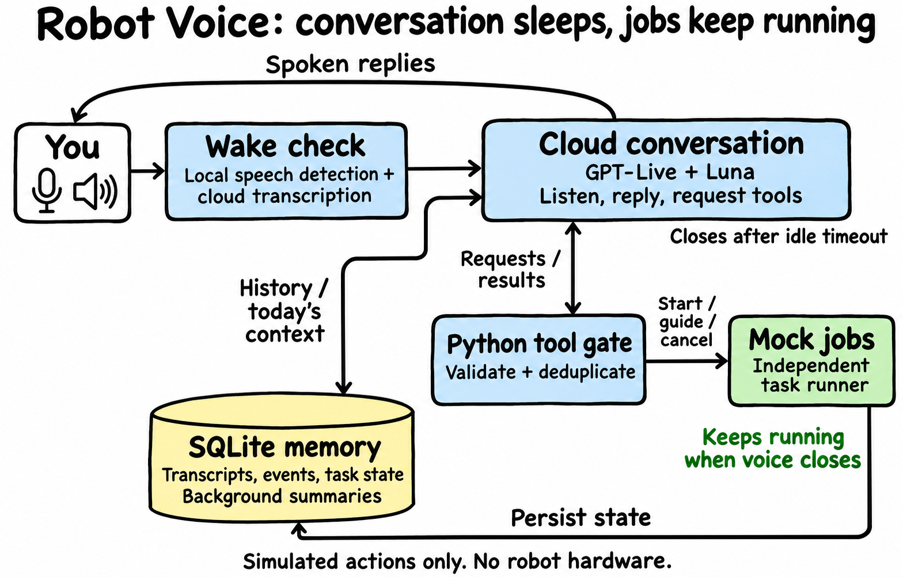

# Robot Voice

**Talk to a simulated robot without making its work depend on the conversation.**

Say “Hey Spot, pick up the red sock.” Ask another question while the job runs. Tell
the voice to go to sleep without stopping the job. Wake it again and ask what happened.

This Python command-line prototype explores that separation. OpenAI handles speech
and conversation; Python validates tool requests, runs **mock robot jobs**, and saves
history in SQLite. There is no robot hardware, camera, ROS integration or physical
movement. It is a prototype for experimenting with voice control, not a robot safety
system.

[How it works](#how-it-works) · [Why these features exist](#why-these-features-exist) ·
[Try it without an API key](#1-try-it-without-an-api-key) ·
[Use your microphone](#2-use-your-microphone) · [What was tested](#what-was-tested)

## How it works



**The important boundary: closing the voice session does not close the task runner.**
Jobs continue only while the Python application is running. Quitting the application
with Ctrl+C cancels its in-process mock jobs; a crash does not magically resume them.

Here is what happens when you say **“Hey Spot, pick up the red sock”**:

1. **Check for a wake phrase.** Local speech detection identifies an utterance. In
   the default mode, OpenAI transcribes it and Python checks for “Hey Spot”. This is
   not a fully local keyword detector.
2. **Open a conversation.** GPT-Live receives the complete opening utterance once
   as text, so you can say the wake phrase and command in one breath. Subsequent
   microphone audio is streamed normally; generated speech plays through your output.
3. **Request a tool, not direct movement.** GPT-Live delegates action requests to
   its managed Luna backend. The backend selects tools; Python checks their arguments,
   prevents duplicate actions and rejects conflicting jobs.
4. **Run the job separately.** The mock task runner starts the pickup and reports
   acceptance immediately. You can keep talking while it works. “Accepted” does not
   mean “finished”; completion comes from the runner, not the model's narration.
5. **Sleep and remember.** Voice closes after an idle period or an explicit sleep
   request. Events and transcripts are saved, and summaries are generated in the
   background. The next wake receives current task state and up to ten memory slices
   from the current local day. If a summary is not ready, saved events provide a fallback.

> **Privacy:** in the default wake mode, nearby speech can be uploaded for
> transcription **before a wake phrase is found**. Standby means the live conversation
> is closed—not that the microphone is off or all cloud use has stopped. Keyboard
> wake mode avoids standby transcription.

## Why these features exist

| Feature | The problem it solves |
| --- | --- |
| **Independent jobs** | A chat timeout or voice disconnect should not abort an already accepted task. |
| **Wake phrase + idle sleep** | You should not have to leave a paid live conversation connected all day. |
| **Whole opening command** | “Hey Spot, do this” should work without repeating the request after connection. |
| **Validated, deduplicated tools** | A model retry must not run the same action twice; malformed arguments must not reach the runner. |
| **Explicit cancellation and guidance** | Talking over the assistant is not a stop command. You can explicitly cancel a job or adjust a running walking policy. |
| **SQLite history + daily memory** | The next conversation should know what happened without pretending the model remembers everything. |
| **Bounded buffers and local budgets** | Slow connections should fail visibly rather than execute a truncated command or reconnect indefinitely. |

The default idle timeout is **30 seconds**. Speech, replies and pending tool work can
hold the session open; a running job can extend the idle hold to **120 seconds** by
default. Jobs still do not require the voice session to remain open.

## 1. Try it without an API key

Start here to check installation. **No microphone, speaker, GPU or API key is needed.**
Use Python 3.12; commands below are for Linux/macOS.

```sh
git clone https://github.com/dctanner/robot-voice.git
cd robot-voice
python3.12 -m venv .venv
source .venv/bin/activate
python -m pip install -e .
robot-voice demo
```

On Windows PowerShell, create the environment with `py -3.12 -m venv .venv` and
activate it with `.\.venv\Scripts\Activate.ps1`; the pip and CLI commands are the same.
If you use [uv](https://docs.astral.sh/uv/), `uv venv --python 3.12` can create the
same environment, and `uv pip install -e .` can install the package.

The demo runs a simulated pickup, checks that its duplicate is not executed, and
shows saved memory. Look for `"task_state":"succeeded"` and
`"duplicate_executions":0`. **It makes zero cloud requests and does not demonstrate
voice input or output.**

For a repeatable demo, choose a new database path:

```sh
robot-voice --database .robot-voice/demo-1.sqlite3 demo
```

## 2. Use your microphone

This mode makes **paid cloud requests**. You need a microphone, an audio output,
and one `OPENAI_API_KEY` with access to `gpt-live-1`, `gpt-6-luna` and
`gpt-transcribe`. Access and prices depend on your account. Start with headphones
so speaker audio does not feed back into the microphone.

### Install audio support

| OS | PortAudio setup |
| --- | --- |
| Debian/Ubuntu | `sudo apt install libportaudio2` |
| macOS | `brew install portaudio`; allow microphone access for your terminal |
| Windows | `sounddevice` wheels normally include PortAudio; allow microphone access |

In the activated environment, install the local speech detector:

```sh
# Linux: install CPU-only PyTorch to avoid unnecessary CUDA packages.
# On macOS/Windows, skip this line and let the vad extra install PyTorch.
python -m pip install torch torchaudio --index-url https://download.pytorch.org/whl/cpu
python -m pip install -e '.[vad]'
```

### Configure your key privately

```sh
cp .env.example .env
# Edit .env locally and replace the placeholder with your OpenAI API key.
```

Copy the file only once—do not overwrite an existing key. On Linux/macOS, run
`chmod 600 .env`; on Windows, restrict its file permissions. `.env` is ignored by
Git. Never put the key in TOML settings, command arguments, issues or conversation logs.
Existing environment variables take precedence over `.env`.

### Check devices, then start talking

```sh
robot-voice doctor
robot-voice devices
robot-voice run --wake-mode keyboard --audio-mode headphones
```

`doctor` makes no paid calls. It checks key **presence**, packages and audio-device
support—not whether your key works or echo cancellation is effective. Fix its audio
or missing-package errors before proceeding.

In keyboard mode, **press Enter, wait for `ACTIVE`, then speak**. This lets you check
audio before adding wake-phrase detection. To use “Hey Spot” instead, exit with
Ctrl+C and start:

```sh
robot-voice run --audio-mode headphones
```

Say the full opening request, for example **“Hey Spot, pick up the red sock on the
floor.”** The chime means the wake was detected; `ACTIVE` means the connection is
ready. You do not need to repeat the opening request.

## A conversation to try

These are requests to a **simulation**, not commands to a physical robot:

| Say | What to expect |
| --- | --- |
| “Hey Spot, walk for four minutes.” | A mock walking job starts; conversation remains available. |
| “What are you doing?” | The assistant queries the runner's current state. |
| “Walk more slowly.” | The backend can update the running policy's simulated speed. |
| “Go to sleep.” | Voice closes; the walking job remains independent. |
| “Hey Spot, are you still walking?” | A new session checks current task state and loads today's memory. |
| “Cancel the walking task.” | Cancellation is requested and acknowledged by the runner. |

You can also request simulated navigation, pickup and expressions. There is no
camera: scene descriptions are mock data, not observations of your room. Switching
between conflicting movement jobs requires acknowledged cancellation first.

**Sleep, cancel and quit are different:** sleep closes voice; cancellation targets
a job; Ctrl+C shuts down the application and its mock jobs. Voice “stop” is never a
safety-rated emergency stop.

## Settings you will probably change

```sh
robot-voice run --wake-phrase "hello robot" --idle-timeout 45 --audio-mode headphones
robot-voice --config examples/config.toml run
```

Global `--config` and `--database` options go **before** the command. See the
[example config](examples/config.toml) and [all settings](robot_voice/config.py).

| Setting | Default / guidance |
| --- | --- |
| Wake phrase | `hey spot`; keyboard wake is available for manual testing. |
| Audio mode | `half-duplex` by default: microphone forwarding is silenced during playback, so you cannot interrupt by speaking. The examples select `headphones`. |
| Speaker use | `external-aec` requires a real OS/hardware echo-cancelled input and matching output. PortAudio does not provide automatic echo cancellation. |
| Maximum live session | 300 seconds. |
| Per-process limits | 1,200 active voice seconds, 100 cloud requests and a $4.50 local estimated-cost cutoff. These reset when the application restarts. |
| History | `.robot-voice/voice.sqlite3`; local timezone determines “today”. |

**Muting does not stop live-session billing.** Budget estimates are not a provider
billing cap. Recheck [current pricing](https://developers.openai.com/api/docs/pricing)
before use. No automatic paid reconnect occurs after a network loss.

For device selection, optional local keyword models, precise timeout behavior and
cost accounting, see the [advanced guide](docs/OPERATIONS.md).

## Read or delete saved history

Stop the running application before maintenance commands:

```sh
robot-voice history --today
robot-voice export --session SESSION_ID --format text
robot-voice delete --session SESSION_ID --yes
```

Replace `SESSION_ID` with an ID from `history`. The database and exports contain
private conversation text and tool details. Normal microphone operation does not
save raw audio, but the cloud provider's retention rules still apply. Redaction is
best effort, **not** a guarantee that credentials or personal data are removed.
Never commit `.env`, databases, recordings or exports. Local deletion does not erase
backups or provider-held data. See [security guidance](SECURITY.md) and the
[storage details](docs/OPERATIONS.md#inspect-export-and-delete).

## What was tested

| Evidence | What it does—and does not—show |
| --- | --- |
| **143 offline tests** | Latest lifecycle and request-identity fixes pass deterministic tests. Lint, type checks, builds and a clean wheel installation also passed. |
| **Real API + synthesized speech** | 15 sessions and 29.87 active minutes, including failed diagnostics. A 10m32s continuous session, tool use and next-wake recall passed on an earlier revision. |
| **Revision boundary** | A later 19-second API smoke validated the first review fixes. The final fixes were tested offline, not with another live smoke or soak. |
| **Not verified** | Real microphone/speaker operation, echo cancellation, interruption while speaking, and room wake accuracy. No physical robot was tested. |

See the [full verification report](docs/VERIFICATION.md) for results, failures and
estimated costs. Synthetic-audio success is **not** proof of a working laptop-speaker
setup. The [original design](ROBOT_VOICE_PLAN.md) also contains future work, not just
implemented or hardware-tested features.

## Develop and extend

```sh
python -m pip install -e '.[dev]'
python -m pytest -q
ruff check robot_voice tests
ruff format --check robot_voice tests
mypy robot_voice
python -m build
```

No GitHub Actions workflows are included. The tests above are offline; paid synthetic
cloud tests require explicit `live-test --allow-paid` opt-in. Follow the
[testing instructions](docs/OPERATIONS.md#development-and-verification), rather than
substituting a room recording.

The main pieces are [`supervisor.py`](robot_voice/supervisor.py) (voice lifecycle),
[`voice/`](robot_voice/voice/) (provider transport), [`tools/`](robot_voice/tools/)
(validation), [`robot/`](robot_voice/robot/) (mock jobs), and
[`memory/`](robot_voice/memory/) (history and summaries). To add tools or replace the
mock adapter, read the [extension contracts](docs/OPERATIONS.md#extending-it).
A real controller must own arbitration, collision avoidance, watchdogs and emergency
stopping; swapping adapters does not make this prototype safe for hardware.

[Contributing](CONTRIBUTING.md) · [Security](SECURITY.md) · [MIT license](LICENSE)
